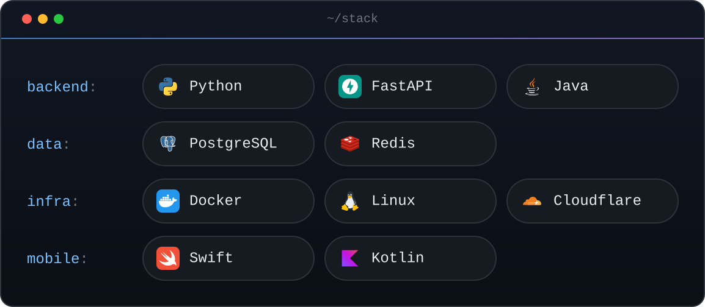

<h1 align="center">Hi, I'm Ilyas 👋</h1>

  Backend developer from Almaty · Student at KBTU ('28) 
  I build APIs with Python &amp; FastAPI and ship them to production.

  
  

---

## 🧰 Tech stack

  

---

## 📂 Selected projects

| Project | What it is | Stack |
| --- | --- | --- |
| [Saga Pattern Checkout](https://github.com/BaonixD/Saga-Pattern-within-a-single-microservice) | E-commerce checkout where every failed step is rolled back with compensating transactions | Python · FastAPI |
| [OneTake](https://github.com/BaonixD/Web-Fullstack-Project) | Team web app for photo, video and design requests: orders, deadlines, roles and an order chat | TypeScript · full stack |
| [Student Portal Dependency Graph](https://github.com/BaonixD/student-portal-dependency-graph) | Component dependency graph in Neo4j with Clean Architecture stability metrics | Neo4j · Cypher · Docker |
| [Money Tracker](https://github.com/BaonixD/money-tracker) | Personal finance tracker | Python |

---

  <a href="https://t.me/Baonix">telegram</a> ·
  <a href="https://github.com/BaonixD?tab=repositories">github</a>

