  <picture>
    <source media="(prefers-color-scheme: dark)" srcset="https://readme-typing-svg.demolab.com?font=Courier+Prime&weight=400&size=34&duration=2500&pause=100000&color=E6EDF3&center=true&vCenter=true&repeat=false&width=616&height=59&lines=Hello%21+I%27m+Ilyas"/>
    
  </picture>

  <picture>
    <source media="(prefers-color-scheme: dark)" srcset="https://readme-typing-svg.demolab.com?font=Courier+Prime&weight=400&size=21&duration=2500&pause=100000&color=E6EDF3&center=true&vCenter=true&repeat=false&width=616&height=37&lines=Backend+developer+from+Almaty"/>
    
  </picture>

  
  
  

  <picture>
    <source media="(prefers-color-scheme: dark)" srcset="./terminal-dark-aaea1521.svg"/>
    
  </picture>

